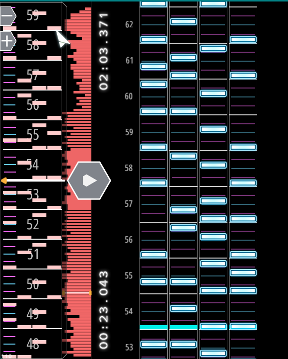
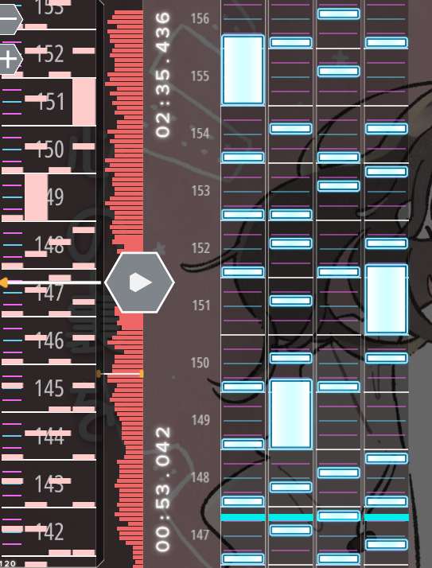

# Auto Melody

直接从音频文件生成高质量的 Malody 4K 谱面。

## 示例



## 快速开始

需要 Python 3.10+、Git LFS 和可播放的 `.ogg` 音频。

你也可以直接把仓库链接丢给 Codex 等 AI 工具，让它们帮你安装项目和生成谱面。

### 1. 获取项目

安装 [Git LFS](https://git-lfs.com/)，然后克隆项目并拉取推理模型和索引：

```bash
git lfs install
git clone https://github.com/woziji2200/auto-melody.git
cd auto-melody
git lfs pull
```


### 2. 安装环境

```bash
python -m venv .venv
# Linux/macOS: source .venv/bin/activate
# Windows PowerShell: .venv\Scripts\Activate.ps1
python -m pip install --upgrade pip huggingface_hub
```

先安装适合本机的 `torch` 和 `torchaudio`，再安装 Auto Melody 所需的库：

```bash
pip install -e .
```

### 3. 下载 MERT

项目使用的 MERT 音频模型不包含在 Git LFS 中。下载模型到默认目录：

```bash
hf download m-a-p/MERT-v1-330M --local-dir data/MERT
```

模型位于 [MERT-v1-330M](https://huggingface.co/m-a-p/MERT-v1-330M)。

对于国内用户，你也可以使用 modelscope 作为替代来下载模型。

```bash
python -m modelscope download m-a-p/MERT-v1-330M --local-dir data/MERT
```

### 4. 生成谱面

在 Malody 谱面编辑器中确认歌曲的恒定 BPM 和 beat zero，然后生成谱面：

```bash
python infer.py song.ogg --levels 5 10 17 --bpm 138 --beat-zero-ms -432
```

默认生成到 `generated/`，包括可导入的 `.mcz` 和同名 `.json` 质量报告。也可以指定输出文件：

```bash
python infer.py song.ogg --levels 17 --bpm 138 --beat-zero-ms -432 --output generated/song-lv17.mcz
```

`--bpm` 和 `--beat-zero-ms` 必须由用户提供；当前版本使用恒定 BPM，不会自动估计拍速或处理变速时间线。支持的音频输入为 `.ogg`。

常用可选项：

- `--cover cover.jpg`：把 JPG/PNG 封面放入 MCZ
- `--author "Your Name"`：设置谱面作者
- `--seed 42`：固定采样随机种子
- `--output path/to/chart.mcz`：指定输出路径

完整参数：`python infer.py --help`。

## 模型文件

仓库通过 Git LFS 提供三阶段模型 checkpoint、训练节奏索引和短语特征。MERT 约 1.2 GB，需按上面的步骤单独下载。推理依赖的文件如下：


```text
data/consensus-salience-v1.pt
data/consensus-rhythm-planner-v1.pt
data/lane-arranger-v2.pt
data/rhythm-train.pt
data/phrase-features.pt
data/MERT/
```

如果提示文件缺失，先确认已运行 `git lfs pull`，并检查 `data/MERT/` 中包含完整模型文件。

## 项目思路

Auto Melody 把生成谱面拆成“什么时候放音符”和“音符放在哪条轨道”两个问题，再用人类谱面的局部写法补充轨道编排：

```text
音乐 + BPM / beat zero + 目标难度
  → 提取音频特征，预测适合放音符的位置
  → 规划每小节的事件数量、落点、同押和 Hold
  → 把节奏骨架编排到四条轨道
  → 检索兼容的人类谱面短语，替换局部轨道写法
  → 打包为 Malody MCZ
```

这样设计是为了分别学习音乐与节奏的关系，以及四轨键型的连续性。检索只调整轨道写法，保留生成的事件落点和每个事件的按键数、Hold 数；找不到兼容短语时保留轨道模型的结果。普通用户可以直接使用仓库提供的模型和索引。

模型分工、检索方式与实现边界见[项目设计](docs/DESIGN.md)。

## 训练与开发

训练流程面向希望研究或重新训练模型的开发者.训练数据准备、完整预处理命令和三阶段训练步骤见[训练指南](docs/TRAINING.md)。
